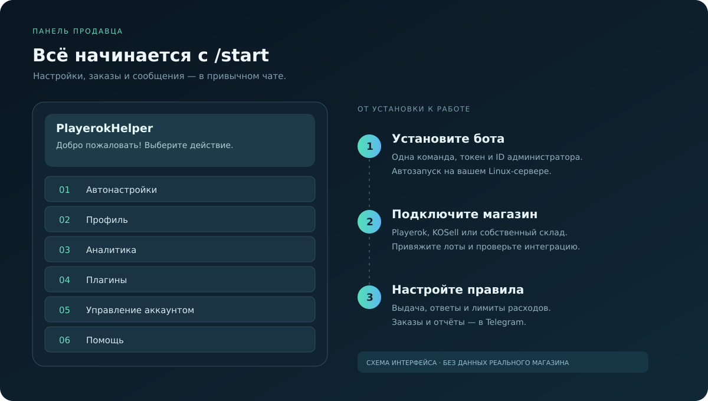

<p align="center">
  
</p>

<p align="center">
  <a href="docs/BETA-0.5.0.md"></a>
  <a href="https://github.com/renderr03/PlayerokHelper/actions/workflows/tests.yml"></a>
  
  
  
</p>

<p align="center">
  <b>Аренда аккаунтов, выдача товаров и ответы покупателям — из Telegram.</b><br>
  PlayerokHelper помогает управлять одним магазином Playerok с вашего сервера.
</p>

<p align="center">
  <a href="#быстрый-старт">Установить</a> ·
  <a href="#возможности">Возможности</a> ·
  <a href="docs/INSTALLATION.md">Документация</a> ·
  <a href="https://github.com/renderr03/PlayerokHelper/issues">Обратная связь</a> ·
  <a href="https://boosty.to/renderr03/donate">Поддержать автора</a>
</p>

---

## Магазин под вашим контролем

Подключите Playerok и KOSell, привяжите лоты и настройте правила выдачи. Бот обрабатывает оплаченные заказы, отвечает на команды покупателей и сообщает вам о ситуациях, которым нужно внимание.

- **Всё в Telegram.** Настройки, заказы, сообщения покупателям и отчёты в одной панели.
- **Ваш сервер и ваши настройки.** Ключи хранятся в локальном `.env`, складские данные — в зашифрованной базе.
- **Установка одной командой.** Консоль спросит токен и ID администратора, затем настроит запуск в фоне и после перезагрузки.

## Бета 0.5.0b2: Stars, SMM и настройка кнопками

Эта ветка содержит бета-сборку. Стабильная `main` остаётся на v0.4.1; GitHub Release сейчас не публикуется и пользователям стабильного бота бета не предлагается.

- **Telegram Stars через Split:** получатель, подтверждение, покупка с TON/USDT-баланса и проверка фактической доставки.
- **SMM API v2:** каталог услуг Default, привязка количества к лоту, разрешённые сайты, прогресс и запросы отмены/восстановления при поддержке услуги.
- **Контроль закупки:** лимиты в валюте поставщика и рублях, курс учёта, предупреждения о балансе и блокировка повторов после неопределённого списания.
- **Сверка:** найденный внешний заказ можно привязать без новой закупки; частичное выполнение и возвраты поставщика учитываются отдельно от возвратов Playerok.

Ключи вводятся скрыто командой `provider-setup` и сохраняются зашифрованно. Остальные настройки доступны в Telegram → «Плагины». Провайдеры выключены по умолчанию, новые лоты сохраняются на паузе.

**[Установка, настройка и проверка беты](docs/BETA-0.5.0.md)**. Реальных закупок при разработке не выполняли; совместимость конкретного аккаунта поставщика нужно проверить перед продажами.

## Исправление v0.4.1

Уведомления об обновлениях и меню `/version` показывают короткое описание обычным текстом, без Markdown-разметки и обрезанных пунктов. Полный отчёт доступен по ссылке. [Подробнее](docs/releases/v0.4.1.md).

## Новое в v0.4.0

🎮 **Собственный пул аренды.** Загружайте свои аккаунты, продавайте аренду и платные продления. Бот резервирует аккаунт за заказом, отслеживает срок и напоминает об окончании. После аренды аккаунт ждёт смены доступа и вашего подтверждения перед следующей выдачей.

🎁 **Бонусы за покупки.** Включите программу и загрузите отдельный склад подарков: покупатель получает бонус за каждые N завершённых новых покупок. Есть команда `!бонус`, учёт себестоимости и сверка спорных отправок.

💬 **Рабочее окно продавца.** Чаты, ожидающие ответа, проблемные заказы, последние сообщения и быстрые ответы с предпросмотром — команда `/inbox`.

📦 **Каталог для большого магазина.** Поиск по названию и ID, страницы, фильтры, массовые инструкции, лимиты, правила ответов и пауза с предпросмотром. Также добавлены предупреждения о низкой марже, независимые фоновые задачи, этапы установки, статус обновления и диагностический ZIP.

**Обновление с v0.3.0:** `/version` → проверка версии → **«Обновить бота»**. Собственный пул и бонусы настраиваются отдельно; существующие источники выдачи сохраняются.

**[Отчёт релиза и настройка новых функций](docs/releases/v0.4.0.md)** · **[История изменений](CHANGELOG.md)**

## Обновление из Telegram

**Обновление из Telegram:** бот проверяет стабильные релизы GitHub раз в 6 часов и сообщает о новой версии. Откройте `/version`, посмотрите изменения и нажмите **«Обновить бота»**. Отдельная служба подготовит пакет, создаст резервную копию и проверит запуск. При ошибке запуска предусмотрен возврат прежнего кода, окружения и базы.

Также добавлены текущая версия в меню, ручная проверка обновлений, настройка уведомлений и журнал последних попыток с понятным результатом.

**Уже стоит v0.2.0?** Один раз выполните прежнюю команду установки из раздела «Быстрый старт», чтобы установить механизм обновления. Следующие совместимые релизы можно устанавливать кнопкой. Обновление из Telegram поддерживается для стандартной Git-установки с systemd; для Docker и ручного запуска сохраняется обычный способ обновления.

**[Отчёт v0.3.0 и инструкция перехода](docs/releases/v0.3.0.md)** · **[История изменений](CHANGELOG.md)**

## В v0.2.0 добавлены

| Функция | Где найти |
| --- | --- |
| 🧙 **Мастер запуска** | `/setup` или «Настроить магазин»: подключения, источник товара, проверка интеграции и первый лот. Playerok подключается по почте или токену, ключи поставщиков вводятся в личном чате. |
| 🚨 **Ранние предупреждения** | «Управление аккаунтом → Ранние предупреждения»: остаток склада, баланс на аренды и проблемы подключения. Состояние сохраняется после перезапуска. |
| 🧪 **Проверка сценария** | Карточка лота → «Проверить сценарий»: текущие условия выдачи и пример сообщения без закупки, резервирования и отправки покупателю. |

**[Отчёт версии и порядок обновления](docs/releases/v0.2.0.md)** · **[История изменений](CHANGELOG.md)**

## Возможности

| | Что умеет PlayerokHelper |
| --- | --- |
| 🎮 **Аренда Steam через KOSell** | Проверка оплаты, закупка аренды, ожидание подготовки аккаунта и выдача доступа в чат Playerok. |
| 🗂 **Собственный пул аренды** | Зашифрованные аккаунты, резерв за заказом, сроки, платные продления и возврат в пул после ручной смены доступа. |
| 🎁 **Подарки за покупки** | Отдельный бонусный склад, настраиваемый порог завершённых покупок и учёт расходов на подарки. |
| 🔑 **Steam Guard и продления** | Покупатель запрашивает код, проверяет срок и выбирает аренду для платного продления. |
| 📦 **Свой склад** | Загрузка текстом или TXT, резерв позиции за заказом, инструкция и учёт себестоимости. |
| 💬 **Ответы покупателям** | Приветствие, ключевые фразы, сообщения по событиям, напоминания и вызов продавца через `!оператор`. |
| 🧑‍💻 **Рабочее окно продавца** | Чаты по состоянию, история сообщений, быстрые ответы и ручная отправка с предпросмотром. |
| 🧭 **Управление лотами** | Скрытие при отсутствии товара, недостаточном балансе или превышении лимита закупки; восстановление после проверки. |
| 🚀 **Поднятие и выставление** | Настройки для отдельных лотов, лимит стоимости операции и общий суточный бюджет платных действий. |
| 📊 **Аналитика** | Продажи, расходы, расчёт прибыли, фильтры, ежедневный отчёт и Excel с десятью листами. |
| ⚙️ **Работа в фоне** | Служба systemd, запуск после перезагрузки сервера, повторный запуск при сбое и резервные копии базы. |

## Управление из Telegram

<p align="center">
  
</p>

*Схематичная иллюстрация меню. Состояние подключения и рабочие данные появятся после настройки вашего магазина.*

В меню есть подключение Playerok, KOSell, Split и SMM. Формы поддерживают кнопки «Назад» и «Отменить»; вводить команды для управления не требуется. [Подключение и навигация](docs/CONNECTIONS.md).

В карточке заказа можно посмотреть состояние выдачи, подготовить ответ покупателю, открыть чат Playerok и разобрать ошибку. Неопределённые списания и отправки передаются на проверку администратору.

## Быстрый старт

Нужен Linux с systemd, Python 3.11+, `venv`, `git`, `curl` и доступ root или sudo. Подойдут Ubuntu 24.04 и Debian 12 с установленными зависимостями.

**Арендовать сервер рекомендую [здесь — ExpressHost](https://t.me/ExpressHost_Bot?start=ref_ASqRPBNS).** Реферальная ссылка автора. При выборе сервера проверьте соответствие требованиям выше.

```bash
curl --connect-timeout 15 --max-time 120 -fL https://raw.githubusercontent.com/renderr03/PlayerokHelper/main/install.sh | bash
```

1. Введите **токен Telegram-бота** и **ID администратора**. Токен вводится скрыто.
2. Установщик создаст ключ шифрования, установит зависимости и запустит службу `playerokhelper`.
3. Откройте своего бота в Telegram и нажмите «Начать».
4. Выберите «Добавить аккаунт Playerok»: вход по почте с кодом или по токену. Остальные шаги, отмена и проверка тестового лота доступны кнопками. [Инструкция](docs/CONNECTIONS.md).

**Перед продажами:** подключите собственные аккаунты Playerok и KOSell, привяжите лоты и выполните проверку скрытия/восстановления тестового лота. До успешной проверки закупка и автовыдача заблокированы; Telegram-панель доступна для настройки.

→ **[Полная инструкция: подключение, автозапуск, Docker и резервные копии](docs/INSTALLATION.md)**

<details>
<summary><b>Уже установлено? Обновление и управление службой</b></summary>

Повторно выполните команду установки. При чистой рабочей копии установщик обновит проект, сохранит существующие настройки и ключ шифрования, затем перезапустит службу.

```bash
systemctl status playerokhelper --no-pager
journalctl -u playerokhelper -f
sudo systemctl restart playerokhelper
```

От root команды выполняются без `sudo`. На сервере без systemd можно использовать ручной режим: [подробности](docs/INSTALLATION.md#установка-одной-командой).

</details>

## Команды покупателя

| Команда | Для чего |
| --- | --- |
| `!помощь` | Список доступных команд |
| `!аренды` | Аренды этого покупателя |
| `!код НОМЕР` | Код Steam Guard для активной аренды |
| `!бонус` | Прогресс до следующего подарка |
| `!срок НОМЕР` | Время окончания аренды |
| `!продлить НОМЕР` | Выбор аренды для заказа продления |
| `!инструкция` | Инструкция по заказу |
| `!оператор` | Обращение к продавцу |

Для собственного пула запрос `!код` передаётся продавцу. Окончание таймера само по себе не меняет пароль и не отключает доступ к Steam: это делает владелец аккаунта перед повторной выдачей.

## Что важно знать

PlayerokHelper — независимый проект с неофициальным интерфейсом Playerok. Он не является официальным продуктом Playerok, KOSell или Telegram.

Подключение к конкретному магазину требует проверки. Автотесты используют подменённые ответы сервисов; порядок живой проверки описан [здесь](docs/LIVE_VERIFICATION.md). KOSell и платные действия Playerok оплачиваются с ваших балансов. Для них задаются отдельные ограничения; известные особенности API и расчёта прибыли собраны в [документации](docs/INSTALLATION.md#отчёты-восстановление-и-ограничения).

## Поддержать автора

Если PlayerokHelper помогает вашему магазину, можно поддержать разработку на Boosty. Поддержка добровольная.

<p>
  <a href="https://boosty.to/renderr03/donate"></a>
</p>

Звезда на GitHub тоже поможет другим продавцам найти проект.

---

**[Документация](docs/INSTALLATION.md)** · **[Вопросы и ошибки](https://github.com/renderr03/PlayerokHelper/issues)** · **[Материалы для публикации](docs/PROMO.md)** · **[Сторонние компоненты](THIRD_PARTY_NOTICES.md)**
